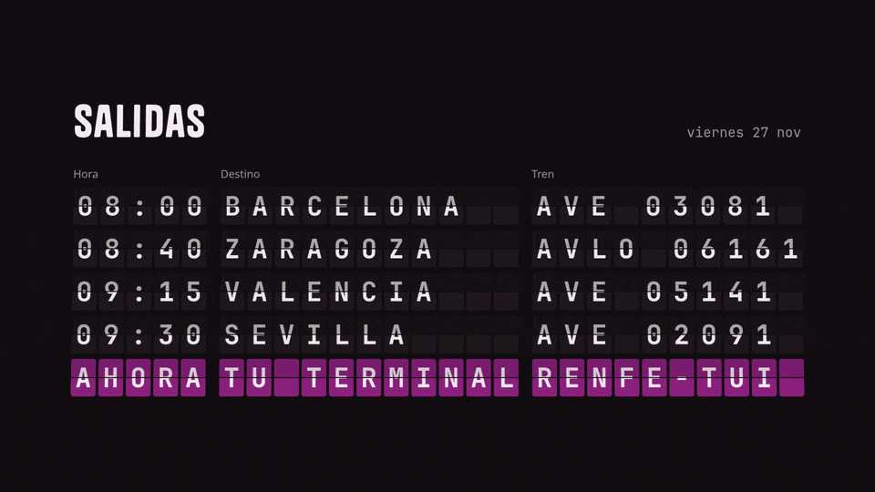
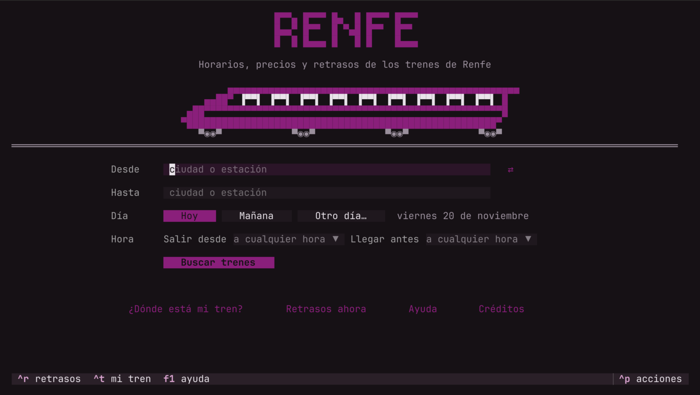
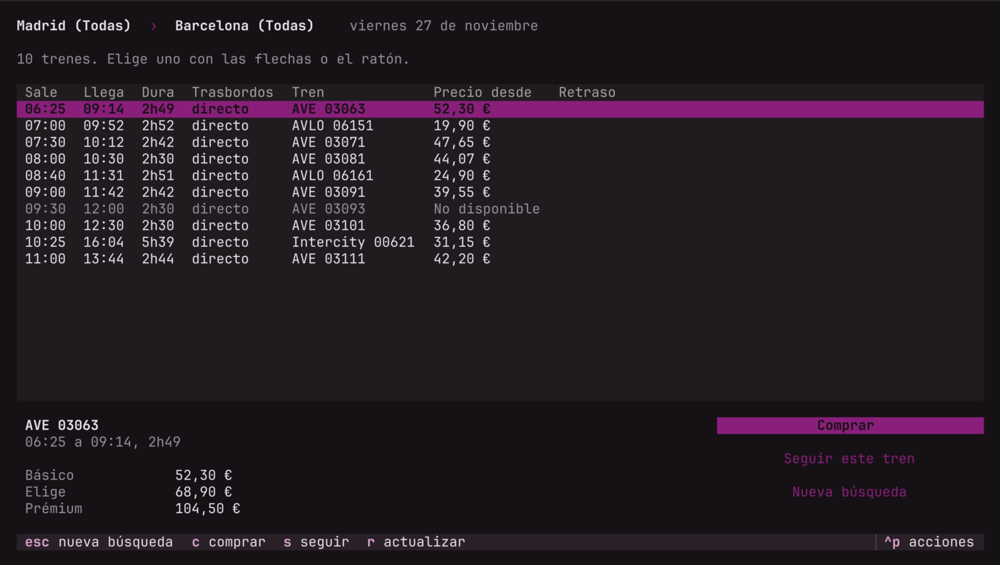
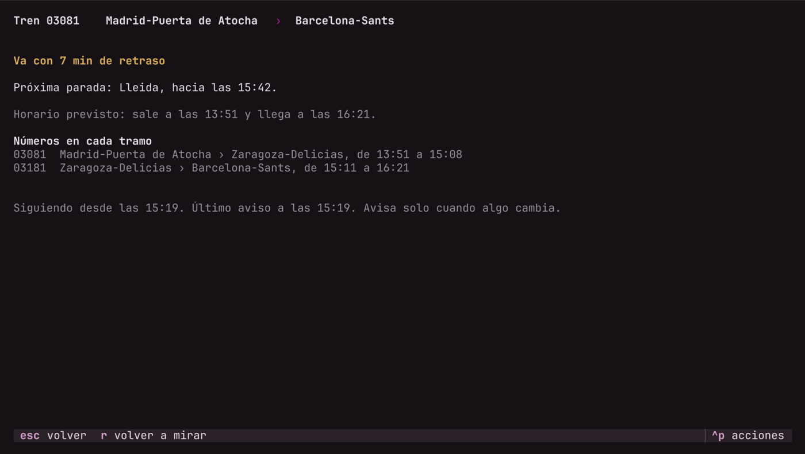
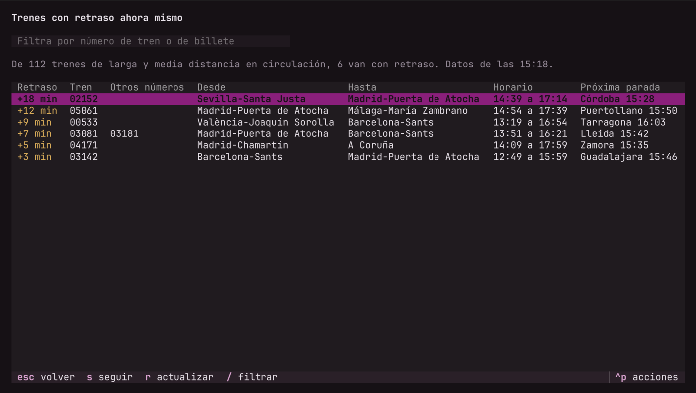

# renfe-tui

[](https://github.com/Sn4pe/renfe-tui/actions/workflows/ci.yml)
[](https://github.com/Sn4pe/renfe-tui/releases/latest)
[](https://www.python.org/)
[](LICENSE)

Renfe train times, fares and live delays in your terminal.



> **Unofficial.** Not affiliated with, endorsed by or supported by Renfe. It runs on
> [renfe-cli](https://github.com/luisgonzaleznf/renfe-cli), which talks to Renfe's web API anonymously, the
> same way the website does before anyone signs in. That API is undocumented and can change without notice.

## Install

You need Python 3.12 or later and [uv](https://docs.astral.sh/uv/).

```sh
uv tool install git+https://github.com/Sn4pe/renfe-tui
renfe-tui
```

This also installs renfe-cli, pinned to a known commit.

| Option | What it does |
|---|---|
| `--lang es\|en` | Interface language. Default: the system's (`LANG`), English unless it is Spanish. |
| `--theme light\|dark` | Colour theme. Default: the system's preference, then the terminal's background, then dark. `RENFE_TUI_THEME` works too. |
| `--no-anim` | Start without the train animation. |

The theme follows the freedesktop portal on Linux, the appearance setting on macOS and the apps setting on
Windows.

## Use

Everything works with the mouse or the keyboard.

- **Find trains:** type where you leave from and where you are going, and pick a suggestion. Suggestions
  come from the station list that ships with renfe-cli, so typing never sends a request to Renfe. `⇄` swaps
  origin and destination. Pick «Today», «Tomorrow» or «Other day…», which opens a calendar, and optionally a
  time to leave after or arrive by. Then press «Find trains».
- **Results:** pick a train to see its fares. «Buy» (`c`) asks how you want to pay and opens Renfe's checkout
  in the browser on that train, where you pick the fare and pay yourself. It needs the checkout extra
  (`uv tool install --reinstall --with playwright git+https://github.com/Sn4pe/renfe-tui`) and Google Chrome.
  Without them, and for trips from 25 January 2027, it opens Renfe's website on that train instead.
  «Follow this train» (`s`) shows where it is.
- **Where is my train?** (`ctrl+t`): its delay, next stop, timetable and the number it carries on each leg.
  It updates whenever something changes, and `r` starts over. The number on your ticket works.
- **Delays now** (`ctrl+r`): every long and medium distance train running late, with its timetable and other
  numbers. `/` filters by a train or ticket number.
- **Help** (`f1`), **Credits**, and the command palette (`ctrl+p`).

To go easy on Renfe, nothing is fetched on its own except a followed train, which renfe-cli checks every 2
minutes for up to 12 hours. If Renfe blocks or rate-limits requests, following stops.

## Screenshots

Taken with sample data.

| | |
|---|---|
|  |  |
|  |  |

## Development

```sh
uv sync
uv run pytest
```

The tests use a fake `renfe` (`tests/fake_renfe.py`) and never call Renfe. `RENFE_TUI_CLI` points the TUI at
another renfe-cli executable. `SHOTS_DIR=/some/dir uv run pytest tests/test_screenshots.py` saves SVG
screenshots of every screen.

## Credits

- [renfe-cli](https://github.com/luisgonzaleznf/renfe-cli) by luisgonzaleznf: every piece of data comes
  through it.
- [Textual](https://github.com/Textualize/textual) by Textualize.

## License

MIT
